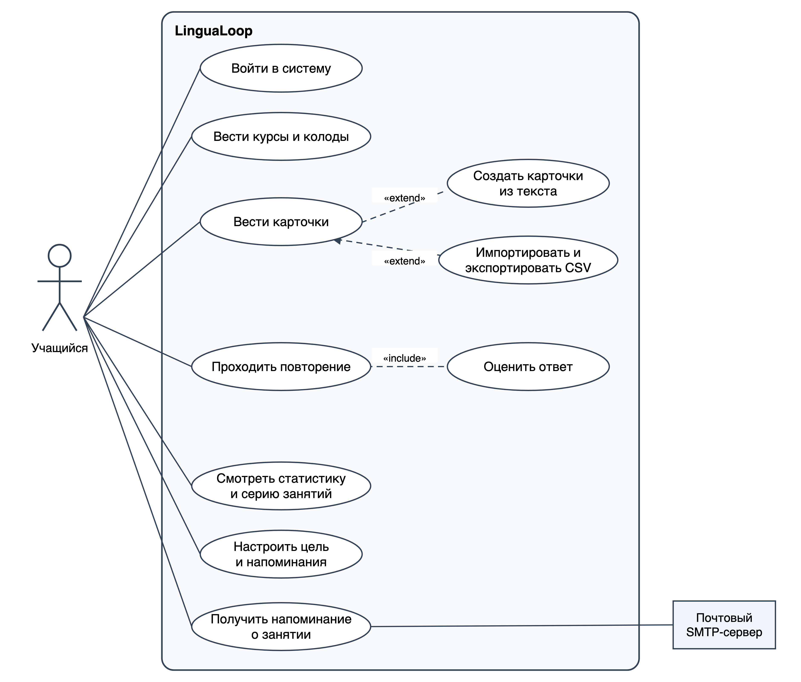
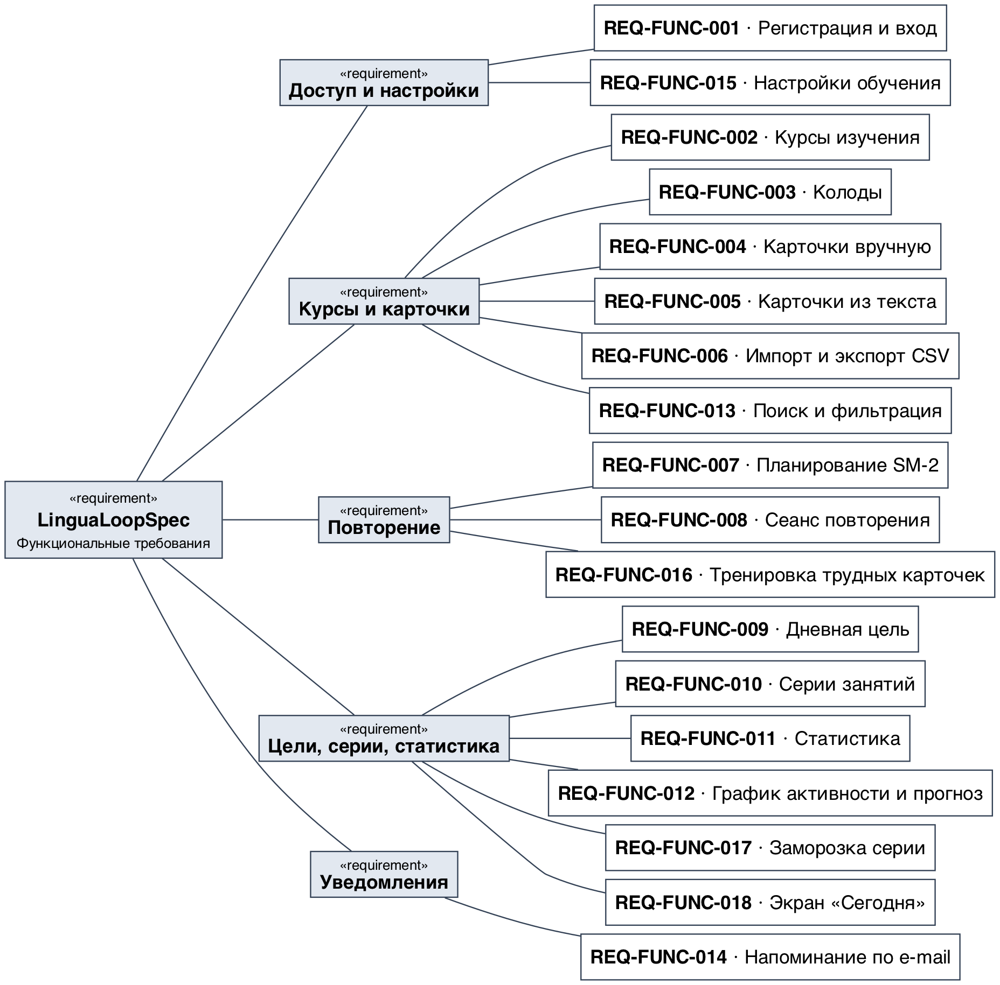
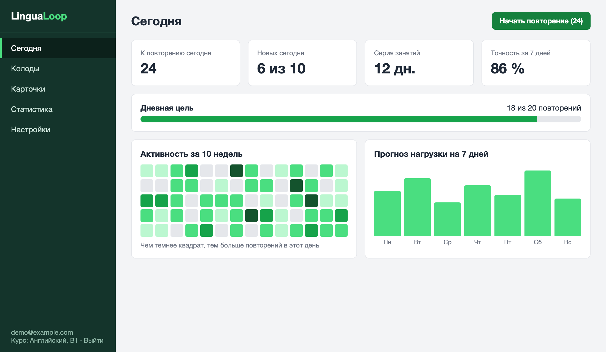
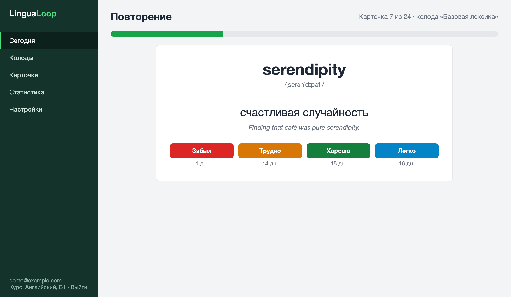
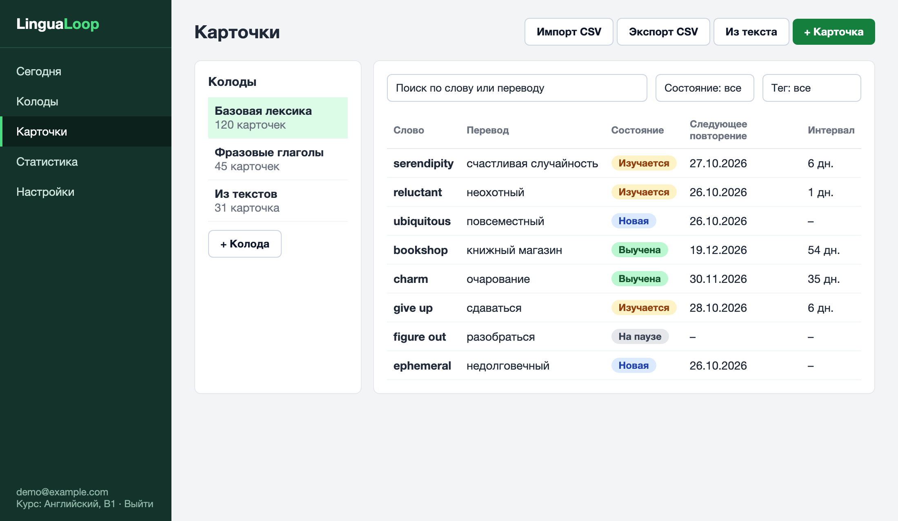
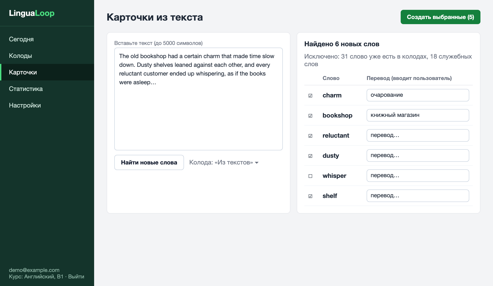
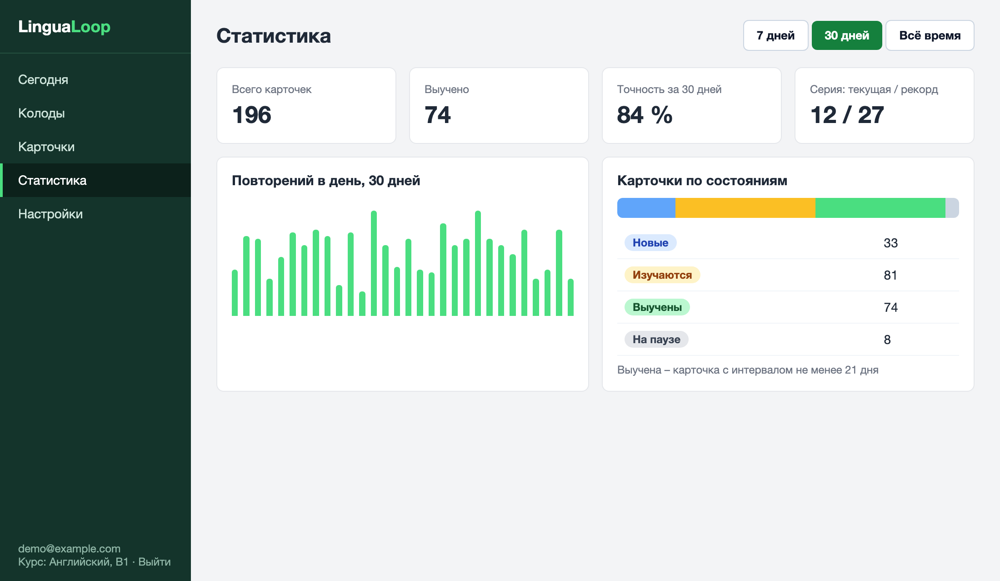
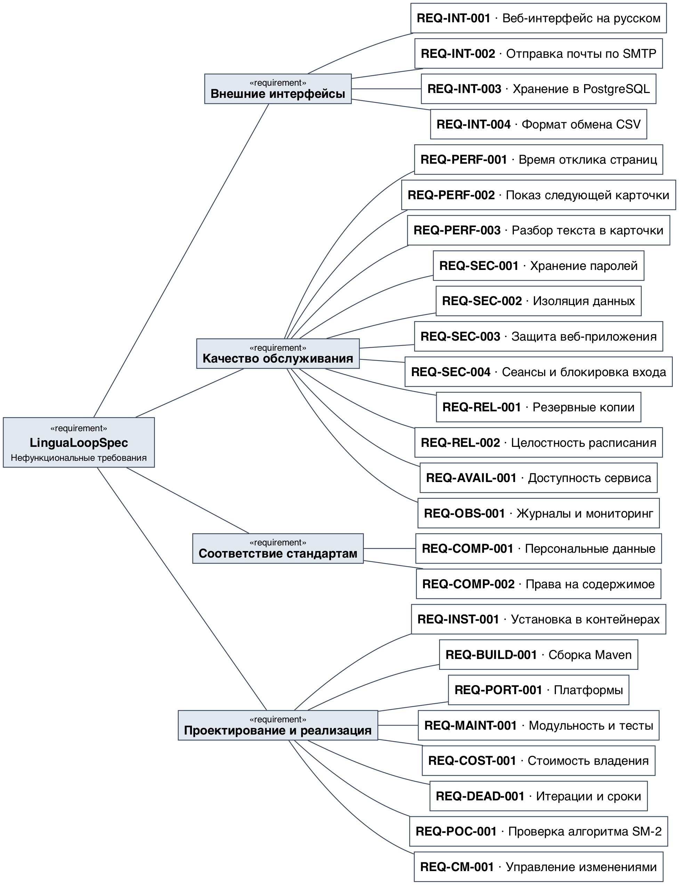
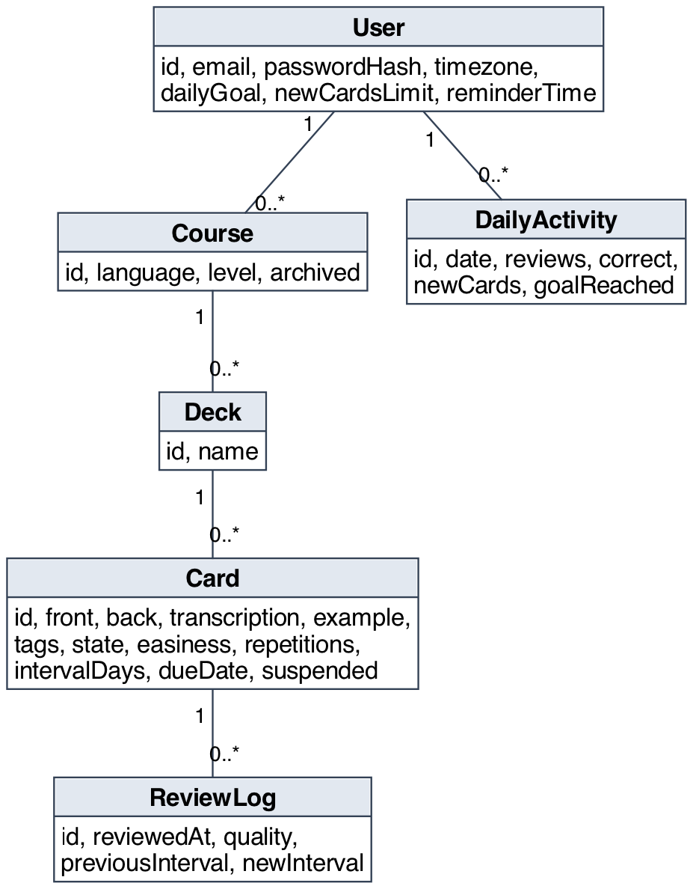

# Спецификация требований к ПО

Для **LinguaLoop** – трекера изучения языков с интервальным повторением

Версия 0.1

Подготовил Дашкевич Р. Д., группа 450503

Белорусский государственный университет информатики и радиоэлектроники, кафедра электронных вычислительных машин

26.10.2026

## Оглавление

* [1. Введение](#1-введение)
* [2. Обзор продукта](#2-обзор-продукта)
* [3. Требования](#3-требования)
  * [3.1 Внешние интерфейсы](#31-внешние-интерфейсы)
  * [3.2 Функциональные требования](#32-функциональные-требования)
  * [3.3 Качество обслуживания](#33-качество-обслуживания)
  * [3.4 Соответствие стандартам](#34-соответствие-стандартам)
  * [3.5 Проектирование и реализация](#35-проектирование-и-реализация)
  * [3.6 ИИ/МО](#36-иимо)
* [4. Верификация](#4-верификация)
* [5. Приложения](#5-приложения)

## История изменений

| Name | Date | Reason For Changes | Version |
|------|------|--------------------|---------|
| Дашкевич Р. Д. | 26.10.2026 | Первая версия: интервью с заказчиком, функциональные (REQ-FUNC-001…018) и нефункциональные требования, мокапы, диаграммы SysML v2 | 0.1 |

---

## 1. Введение

Документ описывает требования к веб-приложению **LinguaLoop** – системе для изучения иностранных языков, которая планирует повторение слов, ведёт статистику и серии занятий и создаёт карточки. Раздел 2 даёт общий контекст, раздел 3 содержит проверяемые требования, раздел 4 – матрицу верификации, раздел 5 – приложения.

### 1.1 Назначение документа

SRS определяет, **что** система должна делать, но не **как** она будет построена. Документ предназначен для разработчика (студент, он же менеджер проекта), заказчика (напарник по ролевой игре, затем преподаватель), будущих тестировщиков и рецензентов. Проектные решения вынесены в документ проектирования (SDD) и записи архитектурных решений (ADR) следующих лабораторных работ.

### 1.2 Область применения продукта

Продукт – LinguaLoop, версия 1.0 (учебный проект по дисциплине «Жизненный цикл разработки программного обеспечения»).

Человек, изучающий язык, быстро забывает слова, если повторяет их без системы, и теряет мотивацию, когда не видит прогресса. LinguaLoop помогает в трёх вещах:

- планирует повторение каждой карточки по алгоритму интервального повторения SM-2, чтобы слово предлагалось в момент, когда его пора вспомнить;
- ведёт статистику, дневную цель и серию занятий;
- создаёт карточки: вручную, из вставленного текста и из файла CSV.

**Бизнес-цели:**

- БЦ-1 – регулярность занятий: не менее 70 % дней месяца с выполненной дневной целью у активного пользователя;
- БЦ-2 – быстрое создание карточек: набор из 20 карточек по тексту длиной 5000 символов создаётся не более чем за 2 минуты от вставки текста до сохранения;
- БЦ-3 – удержание знаний: доля верных ответов на повторениях карточек с интервалом не менее 21 дня не ниже 85 %.

**Входит в версию 1.0:** один пользователь на учётную запись (учащийся), курсы, колоды, карточки (вручную, из текста, из CSV), планирование повторений SM-2, сеанс повторения, дневная цель, серии занятий, статистика, график активности и прогноз нагрузки, напоминания по e-mail.

**Не входит в версию 1.0:** общение и соревнования между пользователями, готовые словари и курсы, автоматический перевод, распознавание речи и проверка произношения, мобильное приложение, работа без подключения к сети.

### 1.3 Определения, акронимы и сокращения

| Term | Definition |
|------|------------|
| Дневная цель | Число повторений в день, которое учащийся стремится выполнять |
| Карточка | Запись для запоминания: слово или фраза, перевод, пример, транскрипция |
| Колода | Набор карточек одной темы внутри курса |
| Курс | Изучаемый язык с указанием уровня |
| Лёгкость (EF) | Коэффициент алгоритма SM-2, определяющий рост интервала между повторениями |
| Повторение | Одна оценка учащимся своего ответа на карточку |
| Серия занятий | Число подряд идущих дней, в каждый из которых выполнена дневная цель |
| Выученная карточка | Карточка с интервалом до следующего повторения не менее 21 дня |
| Интервальное повторение | Метод запоминания, при котором интервалы между повторениями растут |
| SM-2 | Алгоритм интервального повторения SuperMemo версии 2 |
| CSV | Comma-Separated Values – текстовый формат табличных данных |
| MoSCoW | Метод приоритизации: Must, Should, Could, Won't |
| SRS | Software Requirements Specification – спецификация требований к ПО |
| SysML v2 | Systems Modeling Language, версия 2 – язык моделирования систем |
| SMTP | Simple Mail Transfer Protocol – протокол отправки почты |

### 1.4 Ссылки

| Источник | Тип | Расположение |
|----------|-----|--------------|
| ISO/IEC/IEEE 29148:2018. Systems and software engineering – Life cycle processes – Requirements engineering | нормативная | – |
| IEEE 830-1998. Recommended Practice for Software Requirements Specifications | справочная | – |
| Шаблон SRS кафедры ЭВМ БГУИР | нормативная | `srs/srs-template.md` |
| Лабораторная работа № 3 «Разработка и документирование бизнес-требований» | нормативная | методические указания кафедры |
| Wozniak, P. A. Application of a computer to improve the efficiency of learning and remembering (описание алгоритма SM-2) | нормативная для REQ-FUNC-007 | https://super-memory.com/english/ol/sm2.htm |
| Закон Республики Беларусь от 7 мая 2021 г. № 99-З «О защите персональных данных» | нормативная | pravo.by |
| SysML v2 – файл с моделью требований | справочная | `srs/sysml/lingualoop.sysml` |

### 1.5 Обзор документа

Раздел 2 описывает продукт, пользователей, ограничения и допущения. Раздел 3 содержит требования с идентификаторами вида `REQ-[AREA]-[NNN]`, ключевые слова «должен» (обязательное), «следует» (желательное), «может» (допустимое). Приоритет функциональных требований задан по MoSCoW. Раздел 4 связывает требования со способами проверки. Любое изменение требования фиксируется в истории изменений и повышает версию документа.

---

## 2. Обзор продукта

### 2.1 Перспектива продукта

LinguaLoop – новый самостоятельный продукт. Он заменяет бумажные карточки, таблицы и приложения с закрытым алгоритмом, в которых нельзя проверить, как рассчитывается расписание. Система состоит из веб-приложения на Java и реляционной базы данных; из внешних систем использует только почтовый SMTP-сервер (для необязательных напоминаний). Владелец и единственный пользователь учебной версии – разработчик. На рисунке 1 показаны участники и варианты использования.

### 2.2 Функции продукта

- учёт курсов, колод и карточек, в том числе создание карточек из текста и импорт из CSV;
- планирование повторений по алгоритму SM-2 и сеанс повторения с оценкой ответа;
- дневная цель, лимит новых карточек и серии занятий;
- статистика, график активности и прогноз нагрузки;
- экран «Сегодня», объединяющий основные показатели;
- напоминания о занятии по e-mail.

Иерархия функциональных требований показана на рисунке 2.

### 2.3 Ограничения продукта

- Продукт должен быть веб-приложением на языке Java (Java Web); версия JDK не ниже 21.
- Продукт должен использовать реляционную СУБД PostgreSQL (для автотестов допускается H2).
- Продукт должен использовать только программное обеспечение с открытой лицензией.
- Интерфейс должен быть на русском языке; изучаемые языки не ограничиваются, так как содержимое карточек вводит пользователь.
- Данные должны храниться на сервере, развёрнутом самим пользователем; передача данных третьим сторонам запрещена, кроме отправки напоминаний на e-mail самого пользователя.

### 2.4 Характеристики пользователей

| Класс пользователей | Описание | Частота работы | Права |
|---------------------|----------|----------------|-------|
| Учащийся | Школьник, студент или взрослый, изучающий иностранный язык; технической подготовки не требуется | Ежедневно, сеансы по 5–20 минут | Полный доступ к собственным данным |
| Администратор | Отдельная роль не предусмотрена; развёртыванием занимается сам пользователь | Не применимо | Нет |

Требования доступности: контраст текста не ниже 4,5:1, управление основными действиями с клавиатуры (в сеансе повторения – клавиши пробел и цифры от 1 до 4).

### 2.5 Допущения и зависимости

| Допущение / зависимость | Влияние при невыполнении |
|-------------------------|--------------------------|
| Пользователь работает в одном часовом поясе (по умолчанию Europe/Minsk) | Границы дня сдвигаются; серия может считаться неверно, пока пользователь не изменит настройку |
| Пользователь вводит перевод и пример самостоятельно | При появлении автоматического перевода потребуется внешний сервис и пересмотр REQ-COMP-002 |
| Доступен SMTP-сервер (REQ-FUNC-014) | Напоминания недоступны; остальные функции работают без изменений |
| Алгоритм SM-2 остаётся общедоступным | Потребуется собственная реализация или другой алгоритм |
| Объём данных одного пользователя не превышает 5000 карточек и 100000 записей журнала | Потребуется пересмотр REQ-PERF-001 |

### 2.6 Распределение требований

| Итерация | Содержание | Требования |
|----------|------------|------------|
| 1 | Основной цикл: карточки и повторение | REQ-FUNC-001, 002, 003, 004, 005, 007, 008, 009 |
| 2 | Мотивация и статистика | REQ-FUNC-006, 010, 011, 012, 013, 015, 018 |
| 3 | Дополнительные возможности | REQ-FUNC-014, 016, 017 |
| 1–3 | Нефункциональные | REQ-INT, PERF, SEC, REL, AVAIL, OBS, COMP, INST, BUILD, PORT, MAINT, COST, DEAD, POC, CM |

---

## 3. Требования

### 3.1 Внешние интерфейсы

#### 3.1.1 Пользовательские интерфейсы

Интерфейс состоит из боковой навигации (Сегодня, Колоды, Карточки, Статистика, Настройки) и рабочей области. Основной сценарий – сеанс повторения – занимает весь экран и не содержит отвлекающих элементов. Для пустых списков показывается подсказка с кнопкой создания записи; ошибки ввода показываются рядом с полем.

Мокапы экранов:

Исходники мокапов (HTML) лежат в `srs/mockups/`.

- **ID:** REQ-INT-001
- **Title:** Русскоязычный адаптивный веб-интерфейс
- **Statement:** Система должна предоставлять интерфейс на русском языке, корректно отображаемый при ширине окна от 360 до 1920 пикселей.
- **Rationale:** Учащийся повторяет слова и с телефона.
- **Acceptance Criteria:** Все экраны из рисунков 3–7 открываются без горизонтальной прокрутки при ширине 360 пикселей.
- **Verification Method:** Inspection
- **More Information:** Рисунки 3–7.

#### 3.1.2 Аппаратные интерфейсы

Специальные аппаратные интерфейсы не требуются. Система работает на любом сервере или компьютере с поддержкой Java 21 и не менее 2 ГБ оперативной памяти.

#### 3.1.3 Программные интерфейсы

- **ID:** REQ-INT-002
- **Title:** Отправка почты по SMTP
- **Statement:** Система может отправлять письма через SMTP-сервер, параметры которого (адрес, порт, логин, пароль, шифрование) задаются в конфигурации окружения.
- **Rationale:** Нужна для напоминаний.
- **Acceptance Criteria:** При недоступном SMTP-сервере отправка отмечается ошибкой в журнале, остальные функции продолжают работать.
- **Verification Method:** Test
- **More Information:** REQ-FUNC-014.

- **ID:** REQ-INT-003
- **Title:** Хранение данных в PostgreSQL
- **Statement:** Система должна хранить данные в реляционной базе PostgreSQL версии не ниже 15, схема создаётся и изменяется скриптами миграций.
- **Rationale:** Нужны транзакции и ограничения целостности.
- **Acceptance Criteria:** На пустой базе приложение самостоятельно создаёт схему при первом запуске.
- **Verification Method:** Test
- **More Information:** Модель данных – рисунок В.1.

- **ID:** REQ-INT-004
- **Title:** Формат обмена CSV
- **Statement:** Файлы CSV должны иметь кодировку UTF-8, разделитель «;» (при импорте допускается «,»), экранирование значений двойными кавычками и первую строку-заголовок.
- **Rationale:** Файл должен открываться в табличных процессорах.
- **Acceptance Criteria:** Экспортированный файл открывается в Excel без искажения кириллицы; импорт принимает файлы с обоими разделителями.
- **Verification Method:** Test
- **More Information:** REQ-FUNC-006.

### 3.2 Функциональные требования

Модель данных, на которую опираются требования, приведена в приложении В.

#### 3.2.1 Доступ и настройки

- **ID:** REQ-FUNC-015
- **Title:** Настройки обучения
- **Statement:** Система должна позволять изменять дневную цель, лимит новых карточек, время напоминания, включение напоминаний и часовой пояс.
- **Rationale:** Нагрузка у разных учащихся различна.
- **Acceptance Criteria:** Изменённые значения применяются со следующего расчёта очереди и серии; при смене часового пояса записи журнала не изменяются.
- **Verification Method:** Test
- **More Information:** Приоритет Should.

#### 3.2.2 Курсы и карточки

- **ID:** REQ-FUNC-002
- **Title:** Курсы изучения
- **Statement:** Система должна позволять создавать, изменять и архивировать курс изучения: язык, уровень (от A1 до C2 или «не указан»). Курс, содержащий карточки, удалять запрещено, допускается только архивирование.
- **Rationale:** Один учащийся может изучать несколько языков, прогресс по ним не должен смешиваться.
- **Acceptance Criteria:** Архивный курс скрыт в списке по умолчанию и не предлагается при создании колоды; попытка удалить курс с карточками возвращает сообщение об отказе.
- **Verification Method:** Test
- **More Information:** Приоритет Must.

- **ID:** REQ-FUNC-003
- **Title:** Колоды
- **Statement:** Система должна позволять создавать, переименовывать и удалять колоды внутри курса; удаление колоды вместе с карточками должно выполняться только после подтверждения.
- **Rationale:** Колоды группируют карточки по темам.
- **Acceptance Criteria:** Название колоды уникально в пределах курса; после подтверждённого удаления карточки колоды отсутствуют в базе.
- **Verification Method:** Test
- **More Information:** Приоритет Must. Рисунок 5.

- **ID:** REQ-FUNC-004
- **Title:** Карточки вручную
- **Statement:** Система должна позволять создавать, изменять, удалять, приостанавливать и возобновлять карточку: слово или фраза (обязательно, до 200 символов), перевод (обязательно), транскрипция, пример, теги. Новая карточка должна получать состояние «Новая».
- **Rationale:** Карточка – основная единица обучения.
- **Acceptance Criteria:** Карточка без слова или перевода не сохраняется; при добавлении слова, уже имеющегося в колоде, выводится предупреждение; приостановленная карточка не попадает в очередь повторения.
- **Verification Method:** Test
- **More Information:** Приоритет Must.

- **ID:** REQ-FUNC-005
- **Title:** Карточки из текста
- **Statement:** Система должна по тексту на изучаемом языке (до 5000 символов) выделять уникальные слова, исключать слова, уже имеющиеся в карточках курса, и служебные слова из встроенного списка (артикли, предлоги, союзы), показывать найденные слова в порядке убывания частоты и создавать карточки для слов, отмеченных пользователем. Перевод вводится пользователем; в поле «пример» записывается предложение из текста, где слово встретилось.
- **Rationale:** Создание карточек из читаемых текстов ускоряет пополнение словаря (БЦ-2).
- **Acceptance Criteria:** В списке нет слов курса и служебных слов, каждое слово встречается один раз; для созданной карточки пример содержит исходное предложение; текст длиннее 5000 символов отклоняется с сообщением.
- **Verification Method:** Test
- **More Information:** Приоритет Must. Рисунок 6. Автоматический перевод не выполняется.

- **ID:** REQ-FUNC-006
- **Title:** Импорт и экспорт CSV
- **Statement:** Система должна импортировать карточки в колоду из файла CSV (столбцы: слово, перевод, пример, теги) и экспортировать карточки колоды в такой же файл. При импорте ошибка в строке не должна прерывать загрузку остальных строк; по окончании выводится отчёт: создано, пропущено как дубликаты, ошибочных строк.
- **Rationale:** Пользователь может перенести уже накопленные списки слов.
- **Acceptance Criteria:** Файл на 500 строк с двумя ошибочными и тремя повторяющимися строками даёт 495 созданных карточек и отчёт с номерами ошибочных строк; экспорт с последующим импортом в пустую колоду воспроизводит карточки.
- **Verification Method:** Test
- **More Information:** Приоритет Should. REQ-INT-004.

- **ID:** REQ-FUNC-013
- **Title:** Поиск и фильтрация карточек
- **Statement:** Система должна выполнять поиск карточек по слову и переводу (подстрока без учёта регистра) и фильтрацию по колоде, состоянию и тегу.
- **Rationale:** При сотнях карточек прокрутка списка неудобна.
- **Acceptance Criteria:** Результат поиска появляется не позднее 1 секунды; сочетание фильтров применяется по условию «и».
- **Verification Method:** Test
- **More Information:** Приоритет Should. Рисунок 5.

#### 3.2.3 Повторение

- **ID:** REQ-FUNC-007
- **Title:** Планирование повторений SM-2
- **Statement:** Система должна после каждой оценки ответа планировать следующее повторение карточки по алгоритму SM-2. Оценке «Забыл», «Трудно», «Хорошо», «Легко» соответствуют баллы q = 1, 3, 4, 5. Начальные значения: лёгкость EF = 2,5, число успешных повторений n = 0. При q < 3 должны устанавливаться n = 0 и интервал 1 день, EF не изменяется. При q ≥ 3 должны вычисляться новая лёгкость EF' = EF + (0,1 − (5 − q) × (0,08 + (5 − q) × 0,02)), но не менее 1,3, затем n = n + 1 и интервал: 1 день при n = 1, 6 дней при n = 2, при n > 2 – предыдущий интервал, умноженный на EF' и округлённый до целого.
- **Rationale:** Интервальное повторение закрепляет знания при минимальном числе повторений; алгоритм SM-2 опубликован и проверяем.
- **Acceptance Criteria:** Результаты совпадают с контрольными примерами приложения Б; для карточки с EF = 2,5, n = 2 и интервалом 6 дней оценки «Трудно», «Хорошо» и «Легко» дают интервалы 14, 15 и 16 дней и лёгкость 2,36, 2,50 и 2,60.
- **Verification Method:** Test
- **More Information:** Приоритет Must. REQ-POC-001, REQ-MAINT-001. Лёгкость обновляется до расчёта интервала.

- **ID:** REQ-FUNC-008
- **Title:** Сеанс повторения
- **Statement:** Система должна формировать на текущий день очередь из карточек, срок повторения которых наступил (просроченные – первыми), и новых карточек в пределах дневного лимита; показывать лицевую сторону, по команде «Показать ответ» – перевод, транскрипцию и пример, затем предлагать четыре оценки с подсказкой интервала для каждой; после оценки записывать повторение в журнал и планировать карточку по REQ-FUNC-007. Прерванный сеанс должен сохранять уже выставленные оценки.
- **Rationale:** Это основной сценарий работы с продуктом.
- **Acceptance Criteria:** Карточка со сроком в будущем и приостановленная карточка в очередь не попадают; новых карточек в очереди не больше дневного лимита; после закрытия вкладки в середине сеанса оценённые карточки не предлагаются повторно.
- **Verification Method:** Test
- **More Information:** Приоритет Must. Рисунок 4.

- **ID:** REQ-FUNC-016
- **Title:** Тренировка трудных карточек
- **Statement:** Система может запускать сеанс тренировки по карточкам с лёгкостью ниже 2,0 или с ошибкой («Забыл») за последние 14 дней вне расписания; тренировка не должна изменять расписание карточек и не должна засчитываться в дневную цель.
- **Rationale:** Дополнительная проработка трудных слов перед экзаменом или поездкой.
- **Acceptance Criteria:** После тренировки сроки карточек и серия остаются прежними; записи журнала помечены как тренировка.
- **Verification Method:** Demonstration
- **More Information:** Приоритет Could.

#### 3.2.4 Цели, серии, статистика

- **ID:** REQ-FUNC-009
- **Title:** Дневная цель и лимит новых карточек
- **Statement:** Система должна поддерживать дневную цель – число повторений в день (от 5 до 200, по умолчанию 20) и лимит новых карточек в день (от 0 до 50, по умолчанию 10) и показывать прогресс выполнения цели.
- **Rationale:** Цель задаёт ритм занятий (БЦ-1) и не даёт перегрузить себя новыми словами.
- **Acceptance Criteria:** При значении вне допустимого диапазона настройка не сохраняется; прогресс цели равен числу оценок за текущий день по часовому поясу пользователя.
- **Verification Method:** Test
- **More Information:** Приоритет Must.

- **ID:** REQ-FUNC-010
- **Title:** Серии занятий
- **Statement:** Система должна считать серию занятий – число подряд идущих дней, в каждый из которых выполнена дневная цель. Серия должна обрываться, если день закончился без выполнения цели; система должна хранить текущую и наибольшую серии. Границы дня определяются по часовому поясу пользователя.
- **Rationale:** Серия мотивирует заниматься регулярно (БЦ-1).
- **Acceptance Criteria:** При цели 20 и ежедневных занятиях в течение 12 дней серия равна 12; пропуск дня обнуляет серию на следующий день, наибольшая серия сохраняется; в день, когда цель ещё не выполнена, серия не обнуляется до конца дня.
- **Verification Method:** Test
- **More Information:** Приоритет Must. Рисунки 3, 7.

- **ID:** REQ-FUNC-011
- **Title:** Статистика
- **Statement:** Система должна показывать за выбранный период (7 дней, 30 дней, всё время): число повторений, точность (долю ответов с баллом не ниже 3), число новых карточек, а также распределение карточек по состояниям «Новая», «Изучается», «Выучена», «На паузе» и значения текущей и наибольшей серий. Карточка считается выученной, если её интервал не менее 21 дня.
- **Rationale:** Видимый прогресс поддерживает мотивацию и позволяет оценить удержание знаний (БЦ-3).
- **Acceptance Criteria:** Показатели совпадают с данными журнала на тестовом наборе; сумма карточек по состояниям равна общему числу карточек курса.
- **Verification Method:** Test
- **More Information:** Приоритет Must. Рисунок 7.

- **ID:** REQ-FUNC-012
- **Title:** График активности и прогноз нагрузки
- **Statement:** Система должна показывать столбчатую диаграмму числа повторений по дням за 30 дней, календарь активности за 10 недель с градацией по числу повторений и прогноз числа карточек к повторению на ближайшие 7 дней.
- **Rationale:** Прогноз позволяет планировать время занятий.
- **Acceptance Criteria:** Прогноз на первый день равен числу неприостановленных карточек со сроком не позже этого дня, на каждый следующий день – числу карточек со сроком ровно в этот день.
- **Verification Method:** Test
- **More Information:** Приоритет Should. Рисунок 3.

- **ID:** REQ-FUNC-017
- **Title:** Заморозка серии
- **Statement:** Система может позволять один раз в 7 дней применить «заморозку»: пропущенный день не обрывает серию, но и не увеличивает её.
- **Rationale:** Болезнь или поездка не должны сводить на нет многодневную серию.
- **Acceptance Criteria:** После применения заморозки серия сохраняется при пропуске одного дня; повторное применение в течение 7 дней отклоняется.
- **Verification Method:** Test
- **More Information:** Приоритет Could.

- **ID:** REQ-FUNC-018
- **Title:** Экран «Сегодня»
- **Statement:** Система должна на главном экране показывать число карточек к повторению, число новых карточек за день с лимитом, текущую серию, прогресс дневной цели, точность за 7 дней, календарь активности и прогноз нагрузки, а также кнопку начала повторения.
- **Rationale:** Одного экрана достаточно, чтобы начать занятие.
- **Acceptance Criteria:** Показатели совпадают с данными статистики за тот же период; кнопка начала повторения открывает сеанс по REQ-FUNC-008.
- **Verification Method:** Test
- **More Information:** Приоритет Should. Рисунок 3.

#### 3.2.5 Уведомления

- **ID:** REQ-FUNC-014
- **Title:** Напоминание по e-mail
- **Statement:** Система может отправлять учащемуся одно письмо в сутки в заданное им время (по умолчанию 20:00), если дневная цель не выполнена и есть карточки к повторению; в письме указываются число карточек и текущая серия. Напоминания должны отключаться в настройках.
- **Rationale:** Напоминание помогает не прерывать серию.
- **Acceptance Criteria:** При выполненной цели или отсутствии карточек письмо не отправляется; при отключённых напоминаниях письма не создаются; не более одного письма в сутки.
- **Verification Method:** Test
- **More Information:** Приоритет Could. Зависит от REQ-INT-002.

Состояния карточки определяются следующим образом: «Новая» – карточка ни разу не оценивалась; «Изучается» – оценивалась, интервал менее 21 дня; «Выучена» – интервал не менее 21 дня; «На паузе» – карточка приостановлена пользователем. Оценка «Забыл» возвращает выученную карточку в состояние «Изучается».

### 3.3 Качество обслуживания

Иерархия нефункциональных требований показана на рисунке 8.

#### 3.3.1 Производительность

- **ID:** REQ-PERF-001
- **Title:** Время отклика страниц
- **Statement:** Страницы списков, статистики и экран «Сегодня» должны открываться не более чем за 1,5 секунды для 95 % запросов при 5000 карточках, 100000 записях журнала и пяти одновременных запросах на сервере с двумя vCPU и 2 ГБ памяти.
- **Rationale:** Интерфейс не должен мешать занятиям.
- **Acceptance Criteria:** Нагрузочный прогон на тестовых данных показывает 95-й процентиль не более 1,5 секунды.
- **Verification Method:** Test
- **More Information:** –

- **ID:** REQ-PERF-002
- **Title:** Показ следующей карточки и запись оценки
- **Statement:** Выдача следующей карточки сеанса и запись оценки должны занимать не более 300 миллисекунд для 95 % запросов.
- **Rationale:** Задержка между карточками раздражает и сбивает ритм.
- **Acceptance Criteria:** Замер на 200 оценках: 95-й процентиль не более 300 миллисекунд.
- **Verification Method:** Test
- **More Information:** REQ-FUNC-008.

- **ID:** REQ-PERF-003
- **Title:** Разбор текста в карточки
- **Statement:** Выделение слов из текста длиной 5000 символов должно занимать не более 3 секунд для 95 % запросов при 5000 карточках в курсе.
- **Rationale:** Пользователь ожидает результат сразу после вставки текста.
- **Acceptance Criteria:** Замер на 100 запросах: 95-й процентиль не более 3 секунд.
- **Verification Method:** Test
- **More Information:** REQ-FUNC-005.

#### 3.3.2 Безопасность

- **ID:** REQ-SEC-001
- **Title:** Хранение паролей
- **Statement:** Пароли должны храниться только в виде хэша bcrypt со стоимостью не менее 10.
- **Rationale:** Защита при утечке базы.
- **Acceptance Criteria:** В таблице пользователей нет открытых паролей; формат хэша – bcrypt.
- **Verification Method:** Inspection
- **More Information:** –

- **ID:** REQ-SEC-002
- **Title:** Изоляция данных
- **Statement:** Система должна предоставлять пользователю только его собственные курсы, колоды, карточки и журнал; обращение к чужой записи по идентификатору должно возвращать ответ «не найдено».
- **Rationale:** Данные обучения личные.
- **Acceptance Criteria:** Автотест: пользователь B не получает записей пользователя A ни одним из маршрутов.
- **Verification Method:** Test
- **More Information:** –

- **ID:** REQ-SEC-003
- **Title:** Защита веб-приложения
- **Statement:** Система должна работать по HTTPS, защищать формы от подделки межсайтовых запросов, экранировать выводимые данные и использовать параметризованные запросы к базе.
- **Rationale:** Типовые атаки на веб-приложения.
- **Acceptance Criteria:** Форма без токена отклоняется; введённый в карточку текст `<script>` отображается как текст; автоматическая проверка зависимостей не находит критических уязвимостей.
- **Verification Method:** Test
- **More Information:** –

- **ID:** REQ-SEC-004
- **Title:** Сеансы и блокировка входа
- **Statement:** Сеанс должен завершаться после 30 минут бездействия, а после пяти подряд неудачных попыток входа вход для этой учётной записи должен блокироваться на 15 минут.
- **Rationale:** Защита от подбора пароля и чужого доступа.
- **Acceptance Criteria:** Шестая попытка после пяти неудачных отклоняется даже при верном пароле.
- **Verification Method:** Test
- **More Information:** –

#### 3.3.3 Надёжность

- **ID:** REQ-REL-001
- **Title:** Резервное копирование
- **Statement:** Система должна обеспечивать ежедневное резервное копирование базы данных с хранением семи последних копий и описанной процедурой восстановления.
- **Rationale:** Потеря накопленного прогресса недопустима.
- **Acceptance Criteria:** Восстановление из копии на чистой базе проходит успешно и возвращает данные предыдущих суток.
- **Verification Method:** Demonstration
- **More Information:** –

- **ID:** REQ-REL-002
- **Title:** Целостность расписания
- **Statement:** Запись оценки в журнал и обновление расписания карточки должны выполняться одной транзакцией; повторная отправка той же оценки (например, двойное нажатие) не должна создавать вторую запись или менять расписание.
- **Rationale:** Двойное нажатие не должно искажать интервалы и статистику.
- **Acceptance Criteria:** Два одинаковых запроса оценки подряд дают одну запись журнала и одно изменение расписания; при сбое посреди операции состояние карточки не изменяется.
- **Verification Method:** Test
- **More Information:** REQ-FUNC-007, REQ-FUNC-008.

#### 3.3.4 Доступность

- **ID:** REQ-AVAIL-001
- **Title:** Доступность сервиса
- **Statement:** Сервис должен быть доступен не менее 99 % времени в месяц (не более 7,3 часа простоя); плановые работы должны выполняться с 02:00 до 05:00 по Europe/Minsk.
- **Rationale:** Повторения привязаны к дню; недоступность в день срывает серию.
- **Acceptance Criteria:** По журналу проверок состояния за месяц суммарный простой не превышает 7,3 часа.
- **Verification Method:** Analysis
- **More Information:** –

#### 3.3.5 Наблюдаемость

- **ID:** REQ-OBS-001
- **Title:** Журналы и проверка состояния
- **Statement:** Система должна вести журнал событий в структурированном формате (JSON) с уровнями ERROR, WARN, INFO и предоставлять конечную точку проверки состояния; пароли и e-mail пользователей в журнал попадать не должны.
- **Rationale:** Нужна диагностика без раскрытия данных.
- **Acceptance Criteria:** В журнале за тестовый сеанс нет паролей и e-mail; запрос состояния возвращает «UP».
- **Verification Method:** Inspection
- **More Information:** –

### 3.4 Соответствие стандартам

- **ID:** REQ-COMP-001
- **Title:** Защита персональных данных
- **Statement:** Система должна хранить только необходимые данные (e-mail, настройки, содержимое карточек), позволять выгрузить и удалить все данные пользователя по его запросу, а при удалении учётной записи удалять связанные данные.
- **Rationale:** Закон Республики Беларусь № 99-З «О защите персональных данных».
- **Acceptance Criteria:** После удаления учётной записи в базе не остаётся записей, принадлежащих этому пользователю.
- **Verification Method:** Test
- **More Information:** Раздел 1.4.

- **ID:** REQ-COMP-002
- **Title:** Права на содержимое
- **Statement:** Система не должна включать готовые словари, тексты и аудиозаписи третьих лиц; в интерфейсах импорта и создания карточек из текста должно быть указано, что ответственность за права на загружаемое содержимое несёт пользователь.
- **Rationale:** Исключает нарушение авторских прав при распространении продукта.
- **Acceptance Criteria:** В поставку не входят файлы словарей и текстов; предупреждение отображается на экранах импорта и создания из текста.
- **Verification Method:** Inspection
- **More Information:** REQ-FUNC-005, REQ-FUNC-006.

### 3.5 Проектирование и реализация

#### 3.5.1 Установка

- **ID:** REQ-INST-001
- **Title:** Установка в контейнерах
- **Statement:** Система должна запускаться командой `docker compose up` (приложение и PostgreSQL); параметры (адрес базы, SMTP, секреты) должны задаваться переменными окружения, откат – запуском предыдущего образа.
- **Rationale:** Простая установка без администратора.
- **Acceptance Criteria:** На чистой машине с Docker приложение доступно по адресу `http://localhost:8080` не позднее чем через 2 минуты.
- **Verification Method:** Demonstration
- **More Information:** –

#### 3.5.2 Сборка и поставка

- **ID:** REQ-BUILD-001
- **Title:** Воспроизводимая сборка
- **Statement:** Проект должен собираться командой `mvn package` на JDK 21 с фиксированными версиями зависимостей и выпускаться в виде исполняемого jar-файла и образа контейнера.
- **Rationale:** Воспроизводимость и трассируемость выпусков.
- **Acceptance Criteria:** Сборка на чистом клоне репозитория завершается успешно, тесты проходят.
- **Verification Method:** Test
- **More Information:** –

#### 3.5.3 Распределение

Система развёртывается одним экземпляром приложения и одной базой данных; распределённое развёртывание не требуется.

#### 3.5.4 Сопровождаемость

- **ID:** REQ-MAINT-001
- **Title:** Модульность и тесты
- **Statement:** Код должен быть разделён на слои «веб – сервисы – доступ к данным»; планировщик повторений должен быть выделен в модуль, не зависящий от веб-слоя и базы данных, с покрытием модульными тестами не менее 90 %, сервисный слой – не менее 70 %.
- **Rationale:** Алгоритм планирования – ядро продукта, ошибки в нём искажают всё обучение.
- **Acceptance Criteria:** Отчёт покрытия показывает не менее 90 % по модулю планировщика и не менее 70 % по сервисному слою.
- **Verification Method:** Analysis
- **More Information:** REQ-FUNC-007.

#### 3.5.6 Переносимость

- **ID:** REQ-PORT-001
- **Title:** Платформы и браузеры
- **Statement:** Система должна работать под Linux, macOS и Windows с Java 21 и корректно отображаться в двух последних версиях Chrome, Firefox, Safari и Edge.
- **Rationale:** Пользователи используют разные ОС и браузеры.
- **Acceptance Criteria:** Основные сценарии пройдены вручную в каждом перечисленном браузере.
- **Verification Method:** Demonstration
- **More Information:** –

#### 3.5.7 Стоимость

- **ID:** REQ-COST-001
- **Title:** Стоимость владения
- **Statement:** Система должна строиться только на программном обеспечении с открытой лицензией; стоимость хостинга не должна превышать 10 долларов США в месяц.
- **Rationale:** Целевой пользователь – учащийся с ограниченным бюджетом.
- **Acceptance Criteria:** Перечень зависимостей содержит только открытые лицензии (Apache-2.0, MIT, LGPL, MPL, PostgreSQL License).
- **Verification Method:** Inspection
- **More Information:** –

#### 3.5.8 Сроки

- **ID:** REQ-DEAD-001
- **Title:** Итерации разработки
- **Statement:** Разработка должна вестись тремя итерациями согласно таблице в разделе 2.6; итерация считается завершённой, если все её требования приоритета Must проверены.
- **Rationale:** Сроки определяются графиком лабораторных работ курса.
- **Acceptance Criteria:** Матрица верификации (раздел 4) по требованиям итерации не содержит строк в статусе «Запланировано».
- **Verification Method:** Inspection
- **More Information:** Календарные даты итераций согласуются с графиком курса.

#### 3.5.9 Доказательство концепции

- **ID:** REQ-POC-001
- **Title:** Проверка алгоритма SM-2
- **Statement:** До начала итерации 1 должен быть выполнен прототип планировщика, воспроизводящий контрольные примеры приложения Б.
- **Rationale:** Главный технический риск – правильность расчёта интервалов и лёгкости.
- **Acceptance Criteria:** Все контрольные примеры дают значения n, EF и интервала, указанные в приложении Б.
- **Verification Method:** Demonstration
- **More Information:** REQ-FUNC-007.

#### 3.5.10 Управление изменениями

- **ID:** REQ-CM-001
- **Title:** Управление изменениями
- **Statement:** Изменения требований и кода должны вноситься через отдельные ветки и запросы на слияние (pull request); изменения схемы базы данных – только скриптами миграций; версия SRS повышается при каждом принятом изменении.
- **Rationale:** Трассируемость изменений.
- **Acceptance Criteria:** В истории репозитория нет прямых коммитов в основную ветку после первого выпуска.
- **Verification Method:** Inspection
- **More Information:** Раздел «История изменений».

#### 3.5.5 Повторное использование

Отдельных компонентов для повторного использования не выделяется; планировщик SM-2 должен быть оформлен как самостоятельный модуль (REQ-MAINT-001).

### 3.6 ИИ/МО

Не применимо: система не содержит компонентов машинного обучения; расписание рассчитывается детерминированным алгоритмом SM-2.

---

## 4. Верификация

| Requirement ID | Verification Method | Test/Artifact Link | Status | Evidence |
|----------------|---------------------|--------------------|--------|----------|
| REQ-FUNC-001 | Test | tests/UC01-auth.md | Запланировано | – |
| REQ-FUNC-002 | Test | tests/UC02-cards.md | Запланировано | – |
| REQ-FUNC-003 | Test | tests/UC02-cards.md | Запланировано | – |
| REQ-FUNC-004 | Test | tests/UC02-cards.md | Запланировано | – |
| REQ-FUNC-005 | Test | tests/UC03-from-text.md | Запланировано | – |
| REQ-FUNC-006 | Test | tests/UC04-csv.md | Запланировано | – |
| REQ-FUNC-007 | Test | tests/unit-sm2.md | Запланировано | – |
| REQ-FUNC-008 | Test | tests/UC05-review.md | Запланировано | – |
| REQ-FUNC-009 | Test | tests/UC06-goal.md | Запланировано | – |
| REQ-FUNC-010 | Test | tests/UC06-goal.md | Запланировано | – |
| REQ-FUNC-011 | Test | tests/UC07-stats.md | Запланировано | – |
| REQ-FUNC-012 | Test | tests/UC07-stats.md | Запланировано | – |
| REQ-FUNC-013 | Test | tests/UC02-cards.md | Запланировано | – |
| REQ-FUNC-014 | Test | tests/UC08-mail.md | Запланировано | – |
| REQ-FUNC-015 | Test | tests/UC06-goal.md | Запланировано | – |
| REQ-FUNC-016 | Demonstration | tests/UC05-review.md | Запланировано | – |
| REQ-FUNC-017 | Test | tests/UC06-goal.md | Запланировано | – |
| REQ-FUNC-018 | Test | tests/UC07-stats.md | Запланировано | – |
| REQ-INT-001 | Inspection | tests/interfaces.md | Запланировано | – |
| REQ-INT-002 | Test | tests/interfaces.md | Запланировано | – |
| REQ-INT-003 | Test | tests/interfaces.md | Запланировано | – |
| REQ-INT-004 | Test | tests/interfaces.md | Запланировано | – |
| REQ-PERF-001 | Test | tests/perf.md | Запланировано | – |
| REQ-PERF-002 | Test | tests/perf.md | Запланировано | – |
| REQ-PERF-003 | Test | tests/perf.md | Запланировано | – |
| REQ-SEC-001 | Inspection | tests/security.md | Запланировано | – |
| REQ-SEC-002 | Test | tests/security.md | Запланировано | – |
| REQ-SEC-003 | Test | tests/security.md | Запланировано | – |
| REQ-SEC-004 | Test | tests/security.md | Запланировано | – |
| REQ-REL-001 | Demonstration | tests/reliability.md | Запланировано | – |
| REQ-REL-002 | Test | tests/reliability.md | Запланировано | – |
| REQ-AVAIL-001 | Analysis | monitoring/uptime-report.md | Запланировано | – |
| REQ-OBS-001 | Inspection | tests/logging-review.md | Запланировано | – |
| REQ-COMP-001 | Test | tests/compliance.md | Запланировано | – |
| REQ-COMP-002 | Inspection | tests/compliance.md | Запланировано | – |
| REQ-INST-001 | Demonstration | docs/install.md | Запланировано | – |
| REQ-BUILD-001 | Test | CI-сборка | Запланировано | – |
| REQ-PORT-001 | Demonstration | tests/browsers.md | Запланировано | – |
| REQ-MAINT-001 | Analysis | отчёт покрытия | Запланировано | – |
| REQ-COST-001 | Inspection | docs/licenses.md | Запланировано | – |
| REQ-DEAD-001 | Inspection | раздел 4 данного документа | Запланировано | – |
| REQ-POC-001 | Demonstration | poc/sm2 | Запланировано | – |
| REQ-CM-001 | Inspection | история репозитория | Запланировано | – |

---

## 5. Приложения

### Приложение А. Замечания заказчика и решения

Рецензирование не проводилось. Таблица заполняется после получения замечаний заказчика в pull request.

### Приложение Б. Контрольные примеры алгоритма SM-2

Примеры используются для проверки REQ-FUNC-007 и REQ-POC-001. Интервал вычисляется по новой лёгкости EF' и округляется до ближайшего целого (0,5 округляется вверх).

| № | Состояние до оценки (n, интервал, EF) | Оценка (q) | n после | EF' | Интервал после, дн. |
|---|----------------------------------------|------------|---------|-----|---------------------|
| 1 | 0, –, 2,5 (новая карточка) | Хорошо (4) | 1 | 2,50 | 1 |
| 2 | 1, 1, 2,5 | Хорошо (4) | 2 | 2,50 | 6 |
| 3 | 2, 6, 2,5 | Трудно (3) | 3 | 2,36 | 14 |
| 4 | 2, 6, 2,5 | Хорошо (4) | 3 | 2,50 | 15 |
| 5 | 2, 6, 2,5 | Легко (5) | 3 | 2,60 | 16 |
| 6 | 5, 30, 1,3 | Трудно (3) | 6 | 1,30 | 39 |
| 7 | 4, 20, 2,5 | Забыл (1) | 0 | 2,50 | 1 |

Примечание – В примере 6 лёгкость по формуле равна 1,16 и ограничивается значением 1,3.

### Приложение В. Модель данных

### Приложение Г. Файлы модели SysML v2

Текстовая модель требований находится в `srs/sysml/lingualoop.sysml`, исходные файлы диаграмм – в `srs/sysml/`.